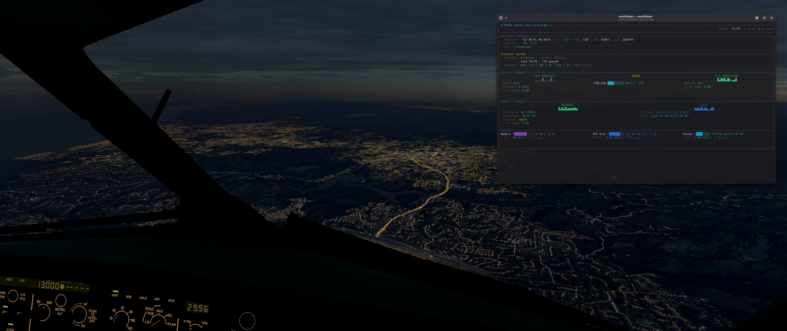
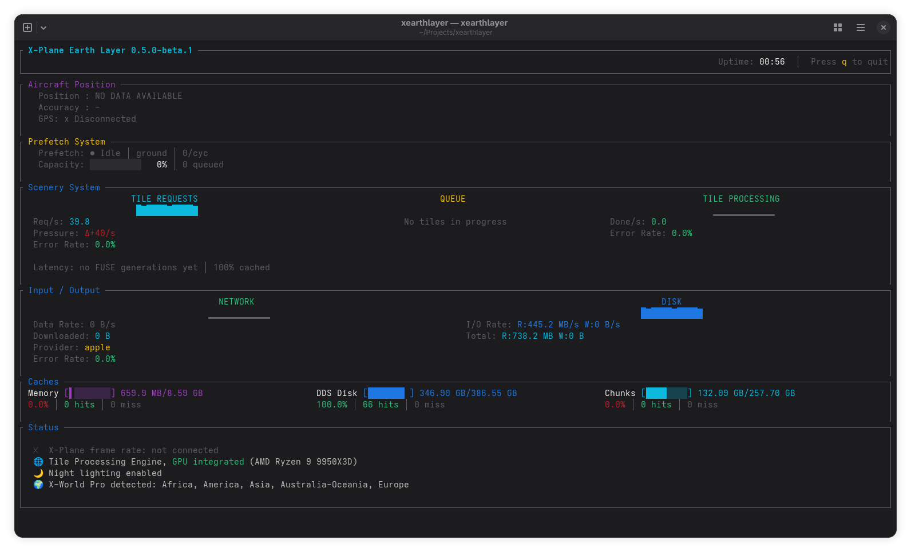
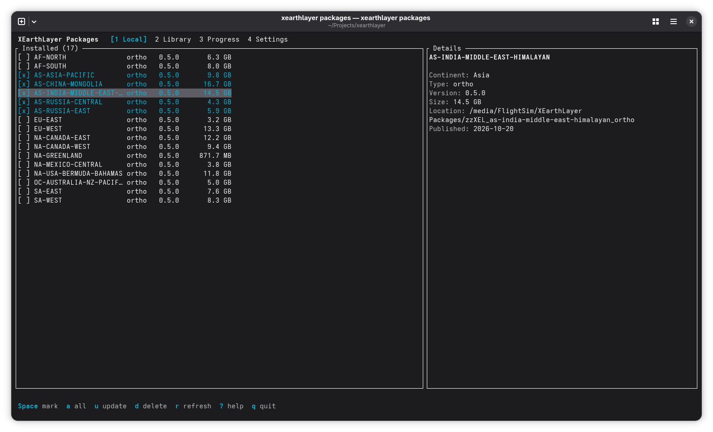

# X-Plane Earth Layer

High-quality streaming orthographic satellite imagery and night time lighting for X-Plane, delivered on demand.



## What It Does

X-Plane Earth Layer (XEarthLayer or XEL) delivers photo scenery to X-Plane without massive downloads. Instead of pre-downloading thousands of gigabytes of textures, XEarthLayer:

1. **Installs smaller regional packages** (tens of gigabytes) containing terrain detail
2. **Streams textures on-demand** as you fly, downloading satellite imagery from a variety of providers

The result: complete orthophoto scenery during the day and cities lit up with lights from dust until dawn. Less overall disk usage than hosting your own ortho tiles, implemented in a fast, modern, memory safe language.

## How It Works

```
Regional Package (base data)      XEarthLayer Service (running)
┌────────────────────────┐        ┌────────────────────────┐
│ Terrain definitions    │        │ Satellite Providers    │
│ (DSF, TER files)       │───────→│ (Bing, Google, Apple,  │
│ References textures    │        │  ArcGIS, MapBox, USGS) │
│ for download           │        │                        │
└────────────────────────┘        │ Generates DDS textures │
                                  │ on-demand              │
                                  └────────────────────────┘
                                             │
                                             ▼
                                  ┌────────────────────────┐
                                  │ X-Plane sees complete  │
                                  │ scenery with textures  │
                                  └────────────────────────┘
```

See [How It Works](docs/how-it-works.md) for detailed architecture.

## Features

- Global Coverage including every major populated continent, excluding Antartica.
- **Night time lighting** available in all regions for the first time using ortho tiles in X-Plane.
- Small regional packages (gigabytes, not terabytes)
- On-demand texture streaming from multiple providers:
  - **Bing Maps** - Free, global coverage (recommended)
  - **Google Maps** - Via GO2 (free) or official API (paid)
  - **Apple Maps** - High quality, auto-acquires tokens
- **Adaptive Prefetch System** - Phase-aware tile prediction
  - Flight phase detection: Ground (ring pattern) vs Cruise (track-based bands)
  - On by default; switch off with `prefetch.enabled = false` or `run --no-prefetch`
- Two-tier caching for instant repeat visits
- High-quality BC1/BC3 DDS textures with mipmaps
- **Multiple compression backends**: ISPC SIMD (default) or GPU-accelerated via wgpu compute shaders
- Real-time TUI dashboard showing cache, download, and prefetch status
- Works with OXO and Ortho4XP-generated scenery
- Linux and macOS support

## Quick Start

### Install a prebuilt package (recommended)

Download the package for your distribution from the
[latest release](https://github.com/samsoir/xearthlayer/releases/latest):
a `.deb` for Debian and Ubuntu, an `.rpm` for Fedora and RHEL, or the
`x86_64-linux.tar.gz` tarball for everything else. Arch users can build from
the AUR. Apple Silicon Macs use Homebrew, the `arm64-macos.pkg` installer package or the
`arm64-macos.tar.gz` tarball, after installing macFUSE; [docs/macos.md](docs/macos.md)
walks through each.

Prebuilt binaries require **glibc 2.34 or newer**, which covers Ubuntu 22.04
LTS, Debian 12 and RHEL 9 onwards. On an older distribution, build from source.

### Or build from source

Building needs **Rust 1.97.1 or newer** and the FUSE 3 development headers.
Install Rust through [rustup](https://rustup.rs), not your distribution's
package manager: several dependencies require a recent compiler, and most
distributions ship one that is too old. rustup also reads this repository's
`rust-toolchain.toml` and selects the correct version automatically.

```bash
# Rust toolchain
curl --proto '=https' --tlsv1.2 -sSf https://sh.rustup.rs | sh

# FUSE 3 headers (Debian/Ubuntu; use fuse3-devel on Fedora)
sudo apt install libfuse3-dev

# Build and install to ~/.local/bin (no sudo required)
git clone https://github.com/samsoir/xearthlayer.git
cd xearthlayer
make install
```

### Then

```bash
# Run the setup wizard (first-time configuration)
xearthlayer setup

# Open the package manager and install a regional package
xearthlayer packages

# Or install one from the command line
xearthlayer packages install eu

# Start XEarthLayer
xearthlayer  # Defaults to 'run' command

# Fly!
```

See [Getting Started](docs/getting-started.md) for the complete guide.

### Real-Time Dashboard

XEarthLayer provides a real-time terminal dashboard showing cache status, download activity, and prefetch progress:



## XEarthLayer Regional Scenery Package Project

XEarthLayer requires regional scenery packages to be installed in order for it to work. XEarthLayer is creating a regional package library for general public use. It is possible for anyone to create and publish their own package server.

[XEarthLayer Scenery Packages](https://github.com/samsoir/xearthlayer-regional-scenery) are hosted on Github, and managed in XEarthLayer from the command line or the package manager TUI.



## Adaptive Prefetch System

XEarthLayer reduces scenery loading stutters by prefetching tiles ahead of your aircraft.

### How It Works

A prefetch box moves with your aircraft and queues the scenery inside it before X-Plane asks for it. On the ground the box is centred on you (GS < 40kt); in cruise it grows with ground speed and shifts ahead in your direction of travel. Prefetch pauses during takeoff and ramps back up once you are climbing, and it yields whenever XEarthLayer or X-Plane is busy.

### Switching Prefetch Off

Prefetch is on by default. Switch it off with `xearthlayer config set prefetch.enabled false`, or for a single run with `xearthlayer run --no-prefetch`.

### Telemetry

XEarthLayer connects to X-Plane automatically via the Web API -- no configuration required. Position, heading, and speed are read directly from the simulator.

See [Configuration](docs/configuration.md#prefetch) and [Adaptive Prefetch Design](docs/dev/adaptive-prefetch-design.md) for tuning options.

## Documentation

### User Guides

| Guide | Description |
|-------|-------------|
| [How It Works](docs/how-it-works.md) | Architecture and system overview |
| [Getting Started](docs/getting-started.md) | First-time setup and usage |
| [Configuration](docs/configuration.md) | All configuration options |
| [Package Management](docs/package-management.md) | Installing, updating, removing packages |
| [Running the Service](docs/running-service.md) | Streaming service options |
| [Content Publishing](docs/content-publishing.md) | Create packages from Ortho4XP |

### Developer Documentation

See [Developer Documentation](docs/dev/) for architecture, design principles, and implementation details.

## CLI Reference

```bash
# Setup & Configuration
xearthlayer setup                     # Interactive setup wizard (recommended for first-time users)
xearthlayer init                      # Create config file with defaults
xearthlayer config list               # View all settings
xearthlayer config set <key> <value>  # Change a setting

# Package Management
xearthlayer packages                  # Package Manager TUI
xearthlayer packages check            # Check available packages
xearthlayer packages install <region> # Install a package
xearthlayer packages list             # List installed packages
xearthlayer packages update <region>  # Update packages
xearthlayer packages remove <region>  # Remove a package

# Running
xearthlayer                           # Start streaming (defaults to 'run')
xearthlayer run                       # Mount all packages with real-time dashboard
xearthlayer run --airport KJFK        # Pre-warm cache around an airport

# Cache Management
xearthlayer cache stats               # View cache usage
xearthlayer cache clear               # Clear cache

# Content Publishing
xearthlayer-publish init              # Initialize repository
xearthlayer-publish add --source <path> --region <code>  # Create package
xearthlayer-publish build --region <code>   # Build archives
xearthlayer-publish release --region <code> # Release to library
```

Run `xearthlayer --help` for all options.

## Requirements

- **X-Plane 12**
- **Linux** with FUSE support, or **macOS** with [macFUSE](https://macfuse.io) installed (see the [macOS guide](docs/macos.md))
- **Modern GPU** with 8GB VRAM or higher, 16GB+ recommended (for X-Plane rendering), 24GB+ for all sliders right flying
- **Fast Internet connection** for streaming imagery, recommended 800Mbps downstream or better

> **GPU Encoding:** XEarthLayer includes built-in GPU-accelerated DDS encoding via wgpu compute shaders. This works with any wgpu-compatible GPU and is separate from the X-Plane GPU requirement above. Select it at runtime via `texture.compressor = gpu` in your config.

XEarthLayer is not tested with X-Plane 11, but should work in principle. The scenery packages that are provided by this project are designed for X-Plane 12 only. XEarthLayer using regional scenery packages published for X-Plane 11 should work without issue, your mileage may vary.

## Contributing

```bash
# Install Rust via rustup.rs
curl --proto '=https' --tlsv1.2 -sSf https://sh.rustup.rs | sh

# Clone and build
git clone https://github.com/samsoir/xearthlayer.git
cd xearthlayer
make init
make verify
```

See [Developer Documentation](docs/dev/) for architecture and guidelines.

## Acknowledgments

Architecturally influenced by [AutoOrtho](https://github.com/kubilus1/autoortho) by [kubilus1](https://github.com/kubilus1). XEarthLayer is an independent Rust implementation focused on performance and memory safety.

XEarthLayer Global Scenery created using [OXO: Ortho4 XEarthLayer Orchestrator](https://github.com/XEarthLayer/ortho4-xearthlayer-orchestrator)

Thanks to [@dlicudi](https://github.com/dlicudi) for leading development of the macOS native port of XEarthLayer.

Developed with assistance from [Claude](https://claude.ai) by Anthropic.

 > **NASA VIIRS Land Science Investigator-led Processing System.** (2025). *VIIRS/JPSS1 Lunar BRDF-Adjusted Nighttime Lights Yearly L3 Global 15 arc second Linear Lat Lon Grid* [Dataset](https://doi.org/10.5067/VIIRS/VJ146A4.002). NASA Level 1 and Atmosphere Archive and Distribution System Distributed Active Archive Center. Date Accessed: 2026-10-16

Made with :heart: in California.

## License

Licensed under the MIT License. See [LICENSE](LICENSE) for details.
